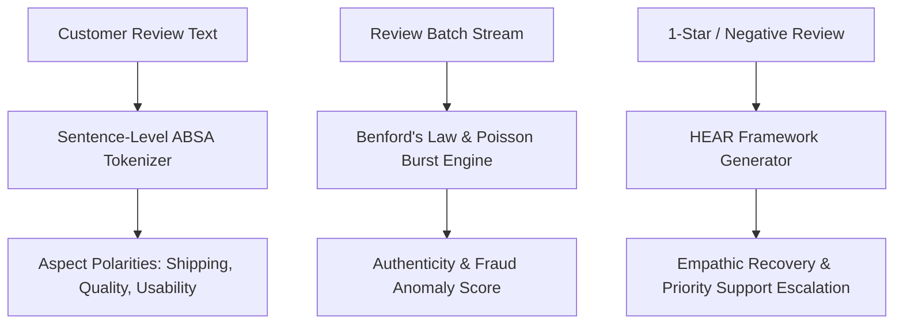

# openclaw-genpark-talktoreview-marketer


OpenClaw GenPark TalkToReview Marketer is a customer sentiment intelligence and brand reputation engine implementing Aspect-Based Sentiment Analysis (ABSA), Benford's Law and Poisson burst review fraud anomaly detection, and automated HEAR framework reputation recovery copywriting.



## Features
- **Aspect-Based Sentiment (ABSA)**: Evaluates granular sentiment polarities across distinct dimensions (shipping, product quality, service, usability).
- **Fraud Anomaly Auditor**: Flags fabricated review campaigns using Benford's Law digit deviations and Poisson temporal clustering bursts.
- **HEAR Recovery Framework**: Generates empathic, brand-aligned responses to de-escalate churn and recover customer trust.

## MCP Runtime Requirements

Use Python 3.10+ for the MCP server. The core `client.py` has no external dependencies; MCP transport requires `mcp>=1.0.0,<2`. From this checkout, install it into the Python environment used by your MCP client:

```bash
python -m pip install -r requirements.txt
```

Use the same Python interpreter to launch `mcp_server.py`. In desktop client configuration, set `command` to that interpreter's absolute path.

## Quickstart

```python
from client import OpenClawGenParkTalkToReviewMarketer

marketer = OpenClawGenParkTalkToReviewMarketer()
res = marketer.decompose_aspect_based_sentiment("Quality is top notch but shipping took forever.")
print("Quality:", res["aspects"]["quality"]["status"])
```

## Local MCP Server

After installing the MCP requirements, launch the local STDIO server:

```bash
python mcp_server.py
```

Point your MCP client at the absolute path to `mcp_server.py` using the same Python interpreter. This repository does not provide a hosted MCP endpoint.

## License
MIT
