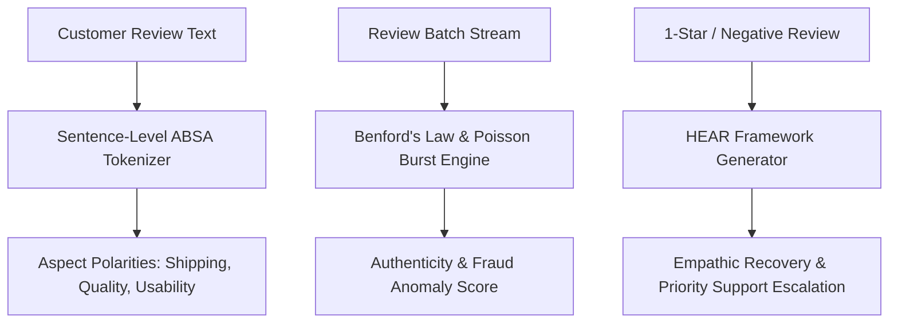

# openclaw-genpark-talktoreview-marketer


OpenClaw GenPark TalkToReview Marketer is a zero-dependency customer sentiment intelligence and brand reputation engine implementing Aspect-Based Sentiment Analysis (ABSA), Benford's Law and Poisson burst review fraud anomaly detection, and automated HEAR framework reputation recovery copywriting.



## Features
- **Aspect-Based Sentiment (ABSA)**: Evaluates granular sentiment polarities across distinct dimensions (shipping, product quality, service, usability).
- **Fraud Anomaly Auditor**: Flags fabricated review campaigns using Benford's Law digit deviations and Poisson temporal clustering bursts.
- **HEAR Recovery Framework**: Generates empathic, brand-aligned responses to de-escalate churn and recover customer trust.

## Quickstart

```python
from client import OpenClawGenParkTalkToReviewMarketer

marketer = OpenClawGenParkTalkToReviewMarketer()
res = marketer.decompose_aspect_based_sentiment("Quality is top notch but shipping took forever.")
print("Quality:", res["aspects"]["quality"]["status"])
```

## License
MIT
